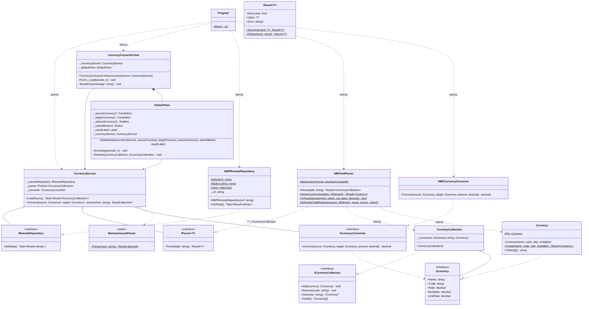

# Currency Converter (Lab 1 – Technologie obiektowe)

Aplikacja okienkowa (WinForms, .NET 10), która pobiera aktualną tabelę A średnich kursów NBP
(`https://static.nbp.pl/dane/kursy/xml/LastA.xml`) i przelicza dowolną kwotę z jednej waluty na drugą.

```
dotnet run
```

## Działanie

1. Po otwarciu okna aplikacja pobiera XML z NBP (timeout 15 s) i parsuje go do kolekcji walut.
   Do kolekcji zawsze dodawany jest złoty (`PLN`, kurs 1), bo NBP nie podaje go w tabeli.
2. Listy walut wypełniają się, domyślnie ustawione jest `EUR → PLN`.
3. Użytkownik wpisuje kwotę i klika **Konwertuj walutę**. Wynik albo komunikat błędu pojawia się pod przyciskiem.

Przeliczenie idzie przez złotówki:

```
kwota_w_PLN = kwota * (kurs_źródłowej / przelicznik_źródłowej)
wynik       = kwota_w_PLN / (kurs_docelowej / przelicznik_docelowej)
```

`przelicznik` jest potrzebny, bo NBP podaje niektóre kursy za 100 jednostek (np. `100 HUF`).

## Struktura projektu

```
CurrencyConverter/
├── Program.cs                        composition root – tworzy konkretne klasy i łączy je ze sobą
├── CurrencyConverterView.cs          formularz (Form) – tylko kontrolki i start ładowania
├── CurrencyConverterView.Designer.cs
├── View/
│   └── DefaultView.cs                obsługa kontrolek: wypełnianie list, kliknięcie, wyświetlanie wyniku
├── Services/
│   ├── CurrencyService.cs            przypadki użycia: załaduj kursy, przelicz kwotę
│   └── MoneyAmountParser.cs          walidacja i parsowanie wpisanej kwoty
├── Model/
│   ├── ICurrency.cs, Currency.cs
│   ├── ICurrencyCollection.cs, CurrencyCollection.cs
│   ├── ICurrencyConverter.cs, NBPCurrencyConverter.cs
│   └── Result.cs                     wynik operacji: wartość albo komunikat błędu
└── DataAccess/
    ├── IRemoteRepository.cs
    ├── NBPRemoteRepository.cs        pobieranie XML z NBP (kodowanie ISO-8859-2)
    └── Parsers/
        ├── IParser.cs
        └── NBPXmlParser.cs           XML NBP → ICurrencyCollection
```

## Warstwy

| Warstwa | Klasy | Odpowiedzialność |
|---|---|---|
| Prezentacja | `CurrencyConverterView`, `DefaultView` | kontrolki, zdarzenia, wyświetlanie |
| Aplikacja | `CurrencyService`, `MoneyAmountParser` | przypadki użycia, walidacja danych od użytkownika |
| Domena | `Currency`, `CurrencyCollection`, `NBPCurrencyConverter`, `Result<T>` | dane i reguły biznesowe, obliczenia |
| Infrastruktura | `NBPRemoteRepository`, `NBPXmlParser` | sieć, format XML |

Zależności idą tylko w dół: prezentacja → aplikacja → domena / infrastruktura.
`CurrencyService` nie zna WinForms, a `NBPCurrencyConverter` nie zna ani UI, ani XML.

## Obsługa błędów

Zamiast wyjątków w logice używany jest `Result<T>`: każda operacja, która może się nie udać,
zwraca albo wartość (`IsSuccess == true`), albo komunikat (`Error`). Wyjątki są łapane tylko na
granicy z bibliotekami (`HttpClient`, `XDocument.Parse`) i zamieniane na `Result`.

## Walidacja

- **kwota** (`MoneyAmountParser`)
  - spacje są ignorowane, separator dziesiętny `.` lub `,` (najwyżej jeden)
  - dozwolone są tylko cyfry i opcjonalny minus na początku, bez notacji naukowej
  - pusta kwota → komunikat
- **waluty** (`CurrencyService`): obie muszą być wybrane i muszą się różnić
- **dane z NBP** (`NBPXmlParser`, `Currency.Create`)
  - niepoprawny XML, brak elementu głównego albo brak pozycji → komunikat
  - każda `<pozycja>` musi mieć nazwę, kod, kurs i przelicznik
  - kod nie może być pusty, kurs i przelicznik muszą być większe od 0
- **sieć** (`NBPRemoteRepository`): brak połączenia lub timeout → komunikat zamiast awarii
- listy walut są typu `DropDownList`, więc nie da się wpisać waluty spoza tabeli

## SOLID

- **S** – każda klasa ma jedno zadanie: pobieranie (`NBPRemoteRepository`), parsowanie
  (`NBPXmlParser`), przechowywanie (`CurrencyCollection`), liczenie (`NBPCurrencyConverter`),
  przypadki użycia (`CurrencyService`), walidacja kwoty (`MoneyAmountParser`), obsługa kontrolek (`DefaultView`).
- **O** – inne źródło danych albo format (np. API JSON NBP) to nowa implementacja `IRemoteRepository`
  lub `IParser<ICurrencyCollection>`; istniejące klasy zostają bez zmian, zmienia się jedna linia w `Program`.
- **L** – dowolna implementacja `ICurrency`, `ICurrencyCollection`, `ICurrencyConverter`,
  `IRemoteRepository` czy `IParser<T>` może zastąpić obecną bez zmian w kodzie, który z niej korzysta.
- **I** – interfejsy są małe, np. `IRemoteRepository` i `ICurrencyConverter` mają po jednej metodzie.
- **D** – `CurrencyService` zależy wyłącznie od interfejsów i dostaje je w konstruktorze;
  konkretne klasy są tworzone tylko w `Program`.

## Diagram klas UML



### Legenda

- `..|>` – realizacja interfejsu
- `-->` – asocjacja (klasa trzyma referencję)
- `o--` – agregacja (zależność wstrzyknięta z zewnątrz, żyje niezależnie)
- `*--` – kompozycja (`DefaultView` jest tworzony przez formularz i żyje razem z nim)
- `..>` – zależność (klasa używa albo tworzy drugą)
- `$` – składowa statyczna
